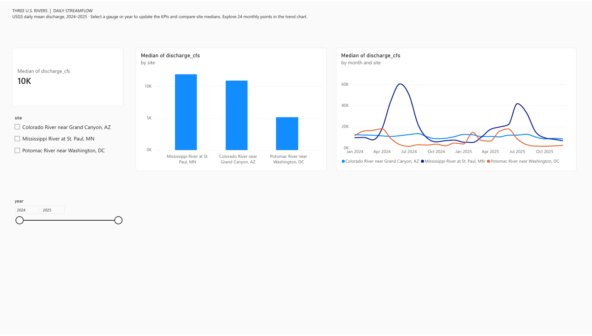
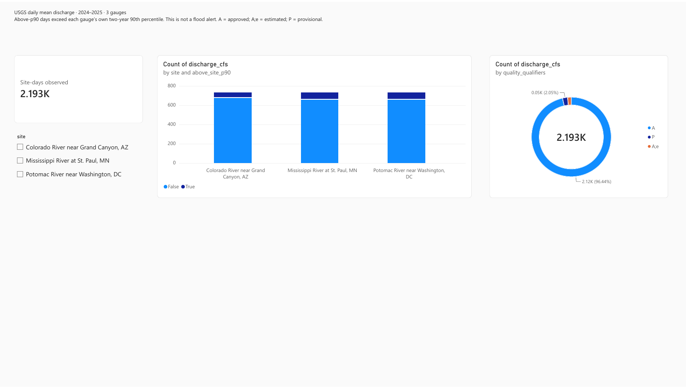

# Three U.S. rivers | Daily streamflow dashboard

**Status: published two-page Power BI report, validated dataset, and downloadable PDF.**

This project compares daily mean discharge at three named USGS streamgages in 2024–2025. It is a site-level time-series study, not a national river assessment or flood-warning system.

## Question and Power BI report

How do daily and monthly discharge patterns differ at three gauges, and when do high-flow days cluster within each gauge's own 2024–2025 distribution?

- [Open the interactive Power BI report](https://app.powerbi.com/groups/e6426da3-9b36-4519-acf1-2434daa552ae/reports/6240d432-1b9b-4ade-9511-70aed291254d/ee4457522652240e0d70?experience=power-bi) (Power BI sign-in may be required).
- [Download the two-page PDF](three_rivers_streamflow_report.pdf).
- Page 1 shows median daily discharge, a gauge comparison, a 24-month trend, and gauge/year controls. Page 2 shows site-day count, above-site-p90 composition, quality qualifiers, and a gauge selector. Clicking charts cross-filters related visuals.

## Source and reproduction

- [USGS Daily Values service](https://waterservices.usgs.gov/docs/dv-service/daily-values-service-details/) via the [exact query](https://waterservices.usgs.gov/nwis/dv/?format=json&sites=01646500%2C05331000%2C09402500&startDT=2024-01-01&endDT=2025-12-31&parameterCd=00060&statCd=00003).
- USGS parameter `00060` is discharge in cubic feet per second; statistic `00003` is the daily mean. Site IDs are 01646500 (Potomac near Washington, DC), 05331000 (Mississippi at St. Paul, MN), and 09402500 (Colorado near Grand Canyon, AZ).
- Run `python build_dataset.py` with Python 3.10+ and network access. The script uses only the standard library, writes the curated CSV, checks the unit and site identities, verifies unique site-days and nonnegative discharge, and writes `validation_summary.json`.
- Snapshot retrieved 2026-11-05 UTC. USGS data, especially provisional values, may change.

## Validated scope

The panel has **2,193 site-days** (731 calendar days × 3 gauges), with all requested daily values present in this snapshot. USGS qualifiers: 2,115 `A` (approved), 33 `A;e` (approved and estimated), and 45 `P` (provisional). Qualifiers are retained rather than collapsed into a single quality label.

The **site-specific 90th percentile** uses a nearest-rank calculation on each site's 731 values. `above_site_p90` is strictly greater than that threshold, so tied values at the threshold are excluded. This is a descriptive rank within the two-year sample, **not a USGS flood stage or hazard threshold**. Raw discharge across different river basins cannot be interpreted as a direct like-for-like risk comparison.

See [metric notes and findings](FINDINGS.md) and [machine-readable validation](validation_summary.json).

## Files

| File | Purpose |
| --- | --- |
| `build_dataset.py` | Reproducible USGS extraction and checks |
| `usgs_daily_streamflow_2024_2025.csv` | Curated Power BI source at site-day grain |
| `validation_summary.json` | Source URL, missingness, qualifiers, and checked metrics |
| `FINDINGS.md` | Definitions, descriptive findings, and limits |
| `three_rivers_streamflow_report.pdf` | Export of both Power BI pages, showing all three gauges |
| `dashboard_overview.png`, `dashboard_quality.png` | Verified page previews |

